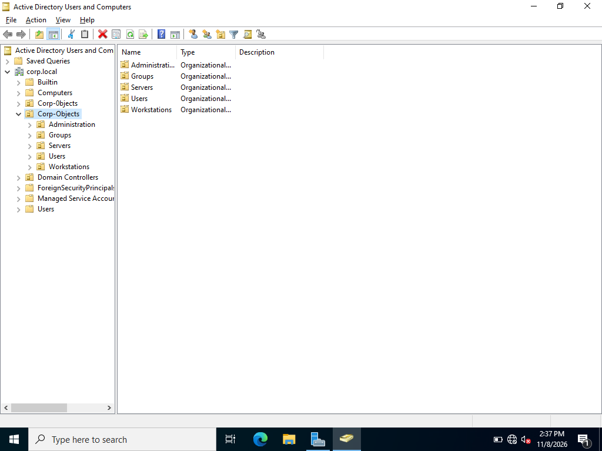
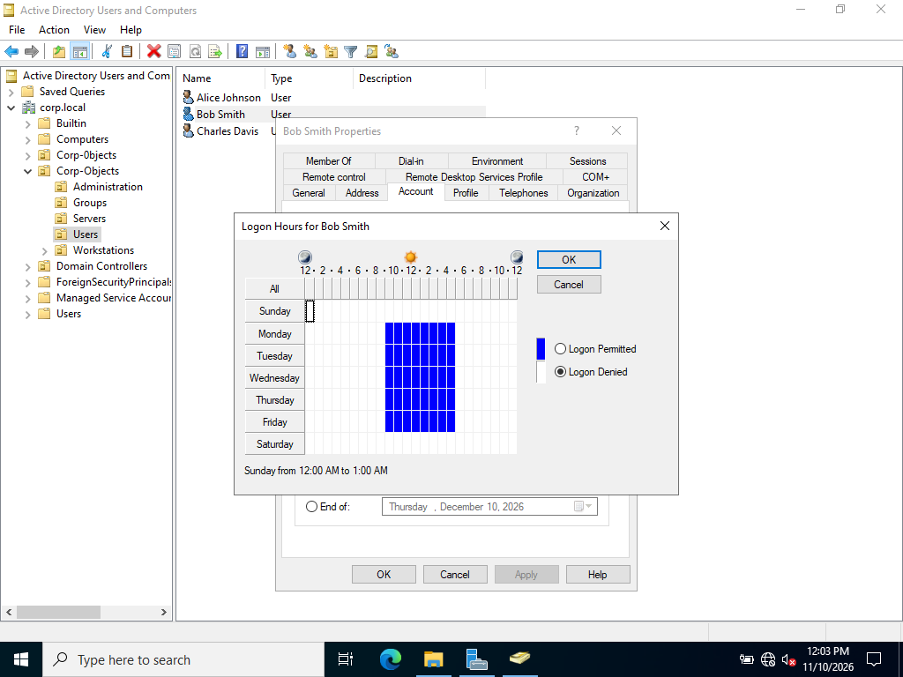
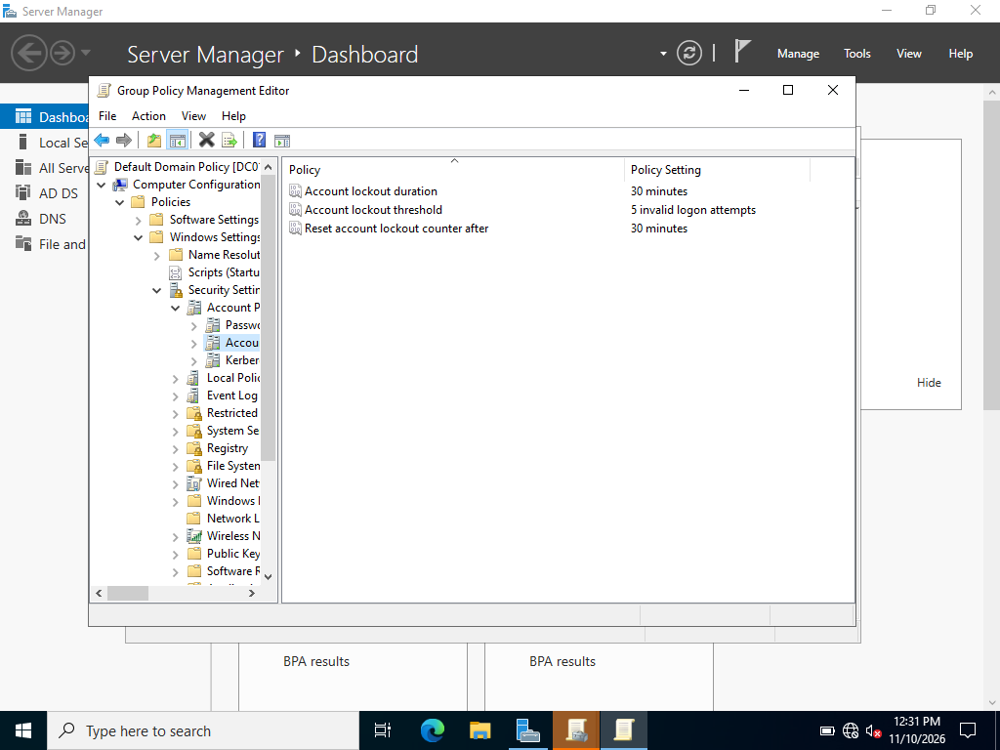
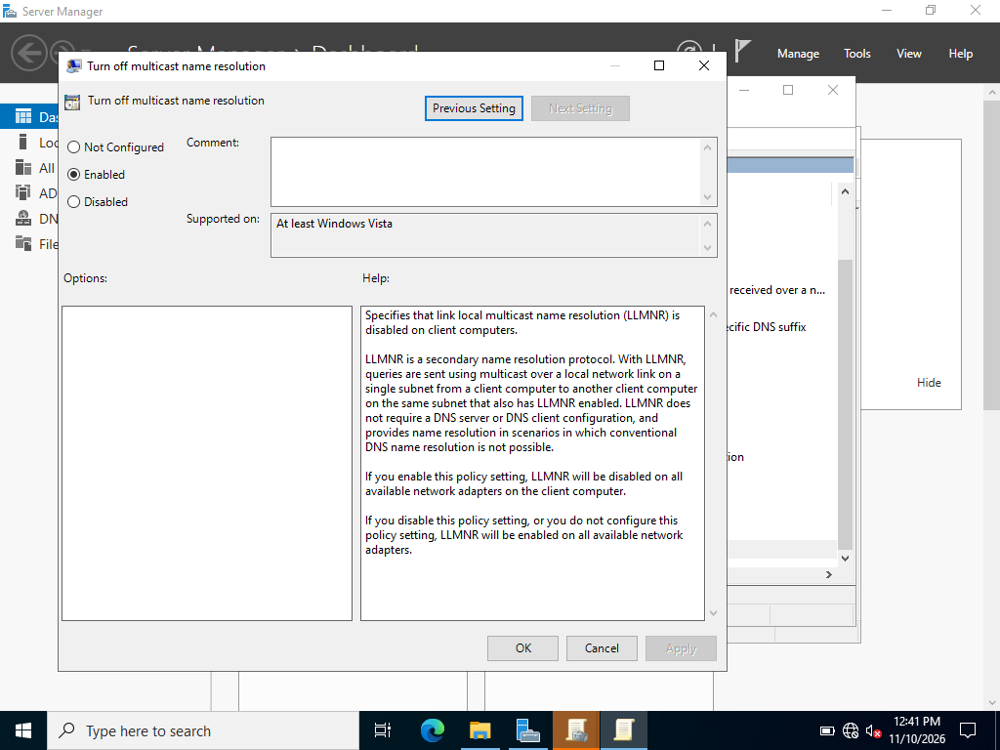
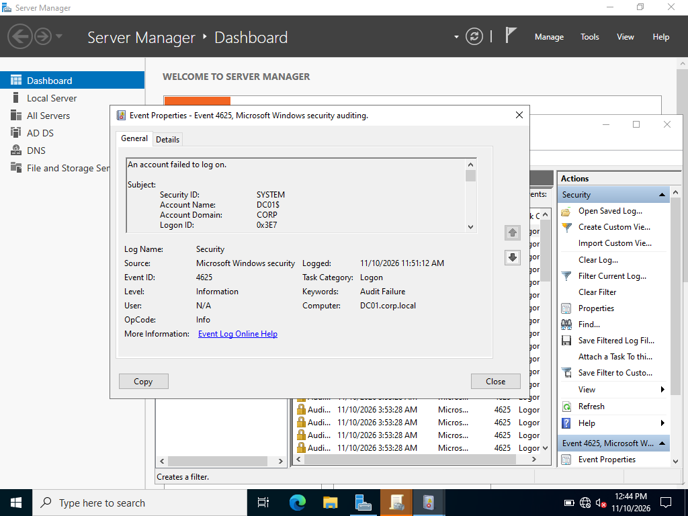

# Active Directory Enterprise Hardening & Security Audit (`corp.local`)

## Executive Summary
This project demonstrates the design, deployment, and security hardening of an Active Directory Domain Services (AD DS) environment (`corp.local`) hosted on Windows Server 2022. The environment implements **Role-Based Access Control (RBAC)**, custom Organizational Unit (OU) structures, account restrictions, protocol mitigations, and centralized security auditing for failed logons.

---

## 1. Active Directory Architecture & OU Structure
The domain architecture separates core administrative objects, user tiers, and infrastructure assets into structured Organizational Units to support granular Delegation of Control and targeted Group Policy enforcement.

* **Domain Name:** `corp.local`
* **Top-Level OU:** `Corp-Objects`
* **Sub-OUs:** `Administration`, `Groups`, `Users`, `Workstations`, `Servers`
* **Role-Based Access Control (RBAC):**
  * **`SG-Admin-Users`:** Designated administrative accounts (`Alex Murphy` / `adm-alex`) for domain infrastructure management.
  * **`SG-Helpdesk-staff`:** Technical support personnel (`Charles Davis`) with extended operational hours and targeted administrative rights.
  * **`SG-Corp-Users`:** Standard end-users (`Alice Johnson`, `Bob Smith`) restricted to regular business hours (9:00 AM – 5:00 PM).

---

## 2. User Account Security & Access Controls

To enforce the Principle of Least Privilege and minimize account compromise risks, specific security policies and account-level restrictions were implemented.

### Account Restrictions & Logon Schedules

* **Logon Hours Enforcement:** Standard users (`Alice Johnson`, `Bob Smith`) in `SG-Corp-Users` are restricted to business hours (9:00 AM – 5:00 PM). Support personnel (`Charles Davis`) retain operational flexibility.
* **Workstation Restrictions:** Standard users are constrained via the `Log On To` attribute to specific hostnames, preventing unauthorized logon attempts on Domain Controllers or administrative workstations.

---

## 3. Implemented Hardening & Security Policies

### A. Account & Password Policy (`Default Domain Policy`)
* **Minimum Password Length:** 14 Characters
* **Password Complexity:** Enforced (Upper/Lowercase, Numbers, Symbols)
* **Account Lockout Threshold:** 5 Invalid Attempts
* **Lockout Duration & Reset Window:** 30 Minutes

### B. Workstation Hardening Policy (`GPO_Workstation_Hardening`)
* **Restricted Groups (Tiered Access Control):** Enforced local `Administrators` group membership, explicitly adding `CORP\SG-Helpdesk-Admins` while automatically revoking unauthorized local administrative privileges across domain workstations.
* **LLMNR Protocol Mitigation:** Disabled Link-Local Multicast Name Resolution via Group Policy (*Turn off multicast name resolution* under `Computer Configuration -> Administrative Templates -> Network -> DNS Client`) to eliminate LLMNR/NBT-NS poisoning and network credential harvesting.

### C. Advanced Event Auditing (`GPO_Audit_Policy`)
Configured granular security auditing subcategories to log identity threats and access attempts:
* **Logon/Logoff:** Audit Logon (Success and Failure) | Audit Account Lockout (Success)
* **Account Management:** Audit User Account Management (Success and Failure)
* **Object Access:** Audit Detailed File Share (Success and Failure)
* **Automatic Session Termination:** Enabled `Network security: Force logoff when logon hours expire` to ensure active sessions are forcibly closed when permitted logon hours end.

---

## 4. Security Telemetry & Verification Logs

Security event generation was validated on `DC01` by inspecting the Windows Security Log in Event Viewer (`eventvwr.msc`).

| Event ID | Event Description | Forensic Significance | Status |
| :--- | :--- | :--- | :--- |
| **4624** | Successful Account Logon | Captures valid domain authentication events and Logon Types (Type 2 Interactive, Type 3 Network). | Verified |
| **4625** | Failed Account Logon | Detects invalid password attempts, brute-force attacks, and credential stuffing activity. | Verified |

